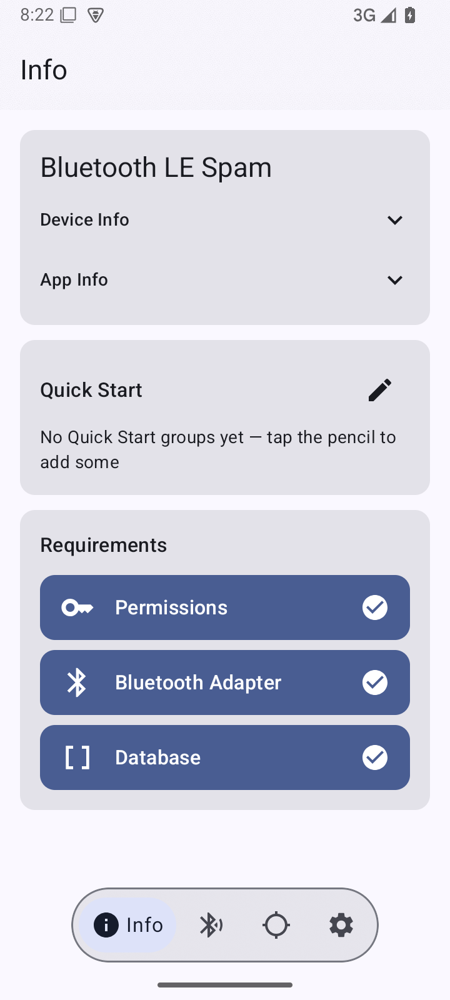
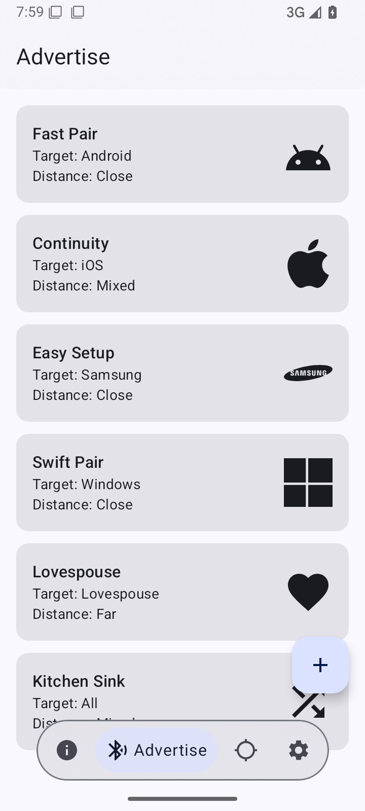
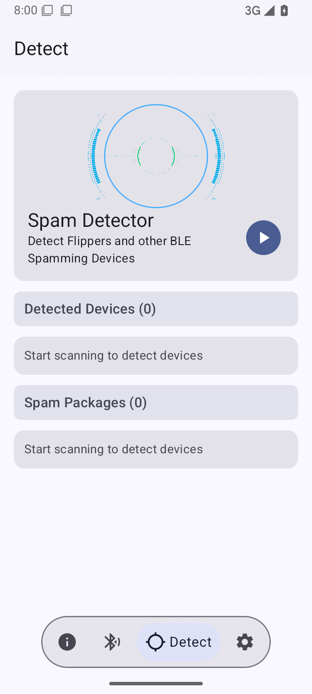
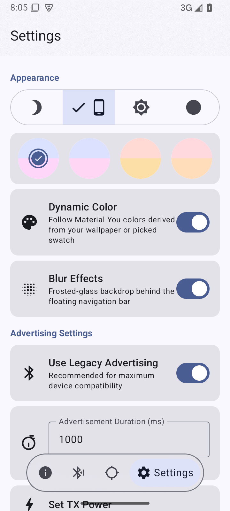
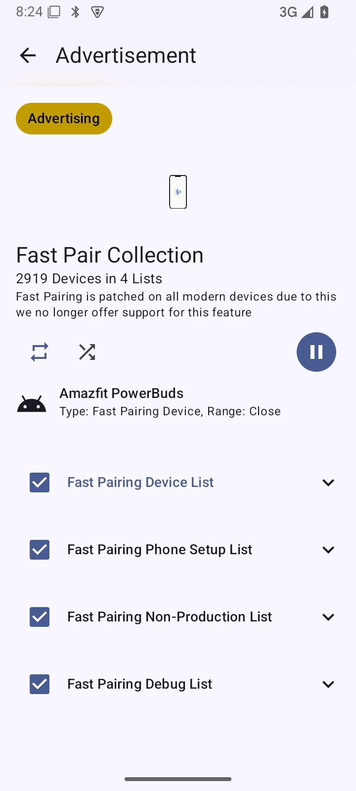
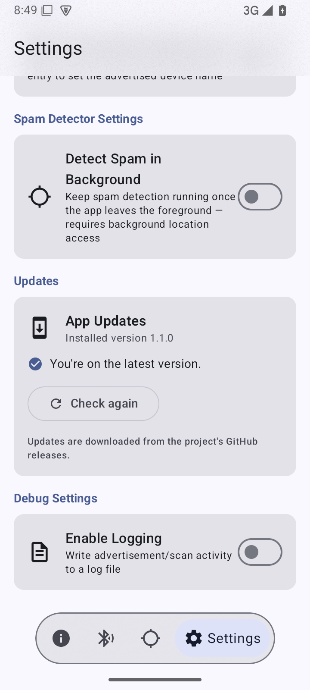

# Bluetooth LE Spam — Revamped Fork

[](https://github.com/royallorde-maker/Bluetooth-LE-Spam)
[](LICENSE)

This is an unofficial, community-maintained fork of
[simondankelmann/Bluetooth-LE-Spam](https://github.com/simondankelmann/Bluetooth-LE-Spam).
It keeps the original app's purpose and package name, and adds a Material 3 interface, a faster
and more reliable first launch, lifecycle fixes, and an in-app updater.

> [!IMPORTANT]
> **This fork is signed with its own release key.** It cannot be installed over the official app
> or the F-Droid build, and the official app cannot be updated with this APK. Uninstall the
> official app first — **that deletes its saved data** — then install this fork. Once you are on a
> fork release, later fork releases update normally and keep your data.

## What's new in 1.1.0

- **Material 3 "Specter" redesign** — a floating, blur-backed navigation bar, four tabs
  (Info, Advertise, Detect, Settings), edge-to-edge layouts, and redesigned cards and dialogs.
- **Theming** — light, dark, OLED black, system dynamic color, or a custom seed color. Blur
  effects are enabled by default and can be switched off on devices where they render poorly.
- **Much faster first launch** — built-in advertisement sets are seeded in bulk instead of one
  database transaction at a time. Subsequent launches repair and synchronize built-in data in the
  background without blocking the UI.
- **Advertising and scanning reliability** — fixed service start/stop handling, foreground
  service notification updates, queue advancing, stale detector results, permission loops,
  first-advertisement skipping, and TX-power preservation when switching service modes.
- **Group editor hardening** — validated names, atomic saves, stable ordering, duplicate-tap
  protection, and clear inline errors.
- **In-app updates** — Settings → Updates checks the fork's GitHub release feed, downloads the
  APK, verifies its package and signing certificate, and opens the system installer.

## Screenshots

| Info | Advertise |
| --- | --- |
|  |  |

| Detect | Settings |
| --- | --- |
|  |  |



The screenshots were taken on Android 15 at a 360 dp phone width. Themes, colors, and blur depend
on the device.

## Install

1. Download `BluetoothLESpam-release.apk` from the
   [latest release](https://github.com/royallorde-maker/Bluetooth-LE-Spam/releases/latest).
2. If the official app or an F-Droid build is installed, uninstall it first. The signing keys
   differ, so Android will refuse the install otherwise. **Uninstalling removes the official
   app's saved collections.**
3. Open the APK and allow "Install unknown apps" for your browser or file manager when asked.
4. Grant the Bluetooth, notification, and (for the Detector tab) location permissions the app
   requests. Android requires location permission for background BLE scanning; the app does not
   collect or upload location data.

Debug builds use the package suffix `.debug`, so they can be installed side by side with a release
build. A debug build cannot update a release build, and vice versa.

## In-app updates

Open **Settings → Updates**. The app fetches
[`updates/version.json`](updates/version.json), compares its `versionCode` with the installed
build, and offers the newer APK when one exists.



- Downloads go through Android's `DownloadManager`; progress and cancellation are shown in the
  card.
- Before launching the installer, the app checks that the APK is readable, has the expected
  package name, and is signed with the same certificate as the installed app.
- Android requires the "Install unknown apps" permission for the first in-app update. The card
  links directly to the right settings page.
- The update manifest and APK are served from this repository's GitHub releases over HTTPS. Only
  `github.com` / `githubusercontent.com` URLs are accepted.

The updater is intentionally not a silent installer — Android always shows the system install
confirmation.

## Build from source

Requirements:

- JDK 21
- Android SDK Platform 37 and build tools
- A device or emulator running Android 8.0 (API 26) or newer with BLE support

Point Gradle at your SDK by creating `local.properties`:

```properties
sdk.dir=/path/to/Android/Sdk
```

Build a debug APK (signed with the debug key, package suffix `.debug`):

```bash
./gradlew :app:assembleDebug
```

Run unit tests:

```bash
./gradlew test
```

Build a release APK (minified and resource-shrunk). Without a signing key the release build falls
back to the debug key, which is fine for local testing but must not be published:

```bash
./gradlew :app:assembleRelease
```

For a properly signed local release, place `app/release.jks` in the project and export:

```bash
export STORE_PASSWORD='...'
export KEY_ALIAS='...'
export KEY_PASSWORD='...'
./gradlew :app:assembleRelease
```

`app/release.jks` is git-ignored. Back it up: losing it means future releases cannot update
installed copies.

## Release process

The GitHub Actions workflow in
[`.github/workflows/android-release.yml`](.github/workflows/android-release.yml) builds, tests,
signs, and publishes the APK whenever `main` receives a change under `app/`, and then updates
`updates/version.json` so the in-app updater advertises the build.

1. Bump `versionCode` and `versionName` in [`app/build.gradle.kts`](app/build.gradle.kts).
2. Commit and push to `main`.
3. The workflow creates the `v<versionName>` tag/release, uploads
   `BluetoothLESpam-release.apk`, and commits the new manifest.
4. The manifest commit does not retrigger the workflow.

Required repository secrets:

| Secret | Contents |
| --- | --- |
| `STORE_FILE` | Base64-encoded `release.jks` (`base64 -w0 app/release.jks`) |
| `STORE_PASSWORD` | Keystore password |
| `KEY_ALIAS` | Release key alias |
| `KEY_PASSWORD` | Key password |

The workflow refuses to publish if `STORE_FILE` is missing, so an unsigned or debug-signed APK
cannot become the "latest" release by accident.

## Functionality inherited from upstream

<details>
<summary>Sending BLE advertisements (pop-ups)</summary>
<br>

The app broadcasts BLE advertisements that mimic pairing and setup services. Nearby devices may
show pairing pop-ups or react to the advertised device. Supported families include:

- Apple (new-device pop-ups and various action modals)
- Microsoft Swift Pair (Windows)
- Samsung Easy Setup
- Google Fast Pair (patched on modern Android devices)
- Lovespouse devices

Advertisement sets can be sent as the full built-in collection or as selected targets, groups,
and custom collections.
</details>

<details>
<summary>Apple iOS 17 crash advertisement</summary>
<br>

A specially crafted BLE payload could temporarily freeze and reboot some iOS 17 devices. This was
partially patched in iOS 17.2 and fully patched in iOS 18. For best results with older devices,
use an advertising interval between 20 and 100 ms and lock/unlock the target phone.
</details>

<details>
<summary>Spam detector</summary>
<br>

The Detector tab scans for known spam advertisement patterns in the background and posts a
notification that identifies Flipper Zero and other common spam sources. Android requires
location permission (including background location for lock-screen detection) to scan BLE in the
background. The app does not collect or transmit location data.
</details>

<details>
<summary>Range and TX power</summary>
<br>

BLE range depends on the phone, antenna, and environment. Android's BLE API lets apps advertise a
declared TX power level, but does not allow arbitrary modification of the transmitted payload
bytes. Devices such as the Flipper Zero can modify those bytes and therefore achieve a longer
effective range for some advertisement types.
</details>

## Project layout

- `app/src/main/java/de/simon/dankelmann/bluetoothlespam/ui/` — Compose screens and navigation
- `app/src/main/java/de/simon/dankelmann/bluetoothlespam/Services/` — advertising and scanning
  foreground services
- `app/src/main/java/de/simon/dankelmann/bluetoothlespam/update/` — in-app update check, download,
  and install verification
- `app/src/main/java/de/simon/dankelmann/bluetoothlespam/Helpers/DatabaseHelpers.kt` — built-in
  data generation, seeding, and synchronization
- `updates/version.json` — manifest consumed by the updater

## Credits

This fork builds directly on the work of Simon Dankelmann and the upstream contributors. Please
support the upstream project:

- [simondankelmann/Bluetooth-LE-Spam](https://github.com/simondankelmann/Bluetooth-LE-Spam)
- [Discord community](https://discord.gg/x4e4Gma585)

Additional research and inspiration:

- [mh from mobile-hacker.com](https://www.mobile-hacker.com/author/boni11/) — BLE device spoofing
  guidelines
- [Willy-JL](https://github.com/Willy-JL), [ECTO-1A](https://github.com/ECTO-1A),
  [Spooks4576](https://github.com/Spooks4576), and
  [Mr-Proxy-source](https://github.com/Mr-Proxy-source) — BLE Spam on Flipper Zero
- [FuriousMAC](https://github.com/furiousMAC) and [Hexway](https://github.com/hexway) — prior
  research
- [mandomat](https://mandomat.github.io/aboutme/) — Lovespouse / "Denial of Pleasure" research
- [tutozz](https://github.com/tutozz) — Easy Setup Buds research
- [K3YOMI](https://github.com/K3YOMI) — spam detector idea

## Disclaimer

This project is provided for educational and security research purposes. Use it only on devices
you own or are authorized to test, and comply with all applicable laws and regulations. BLE
experimentation can affect nearby devices and may have security and privacy implications. The
maintainers provide the software "as is", without warranty, and are not responsible for misuse or
for any damage resulting from its use.

This repository is licensed under the GNU General Public License v3.0. See [LICENSE](LICENSE).
